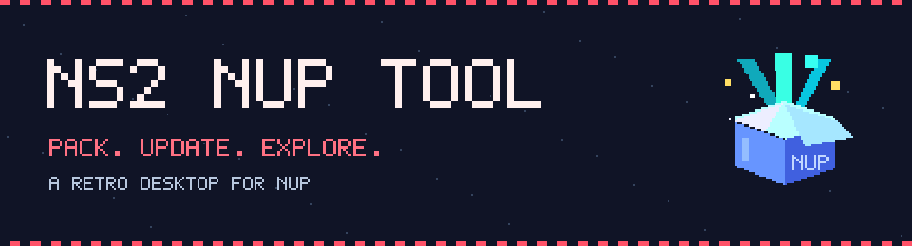
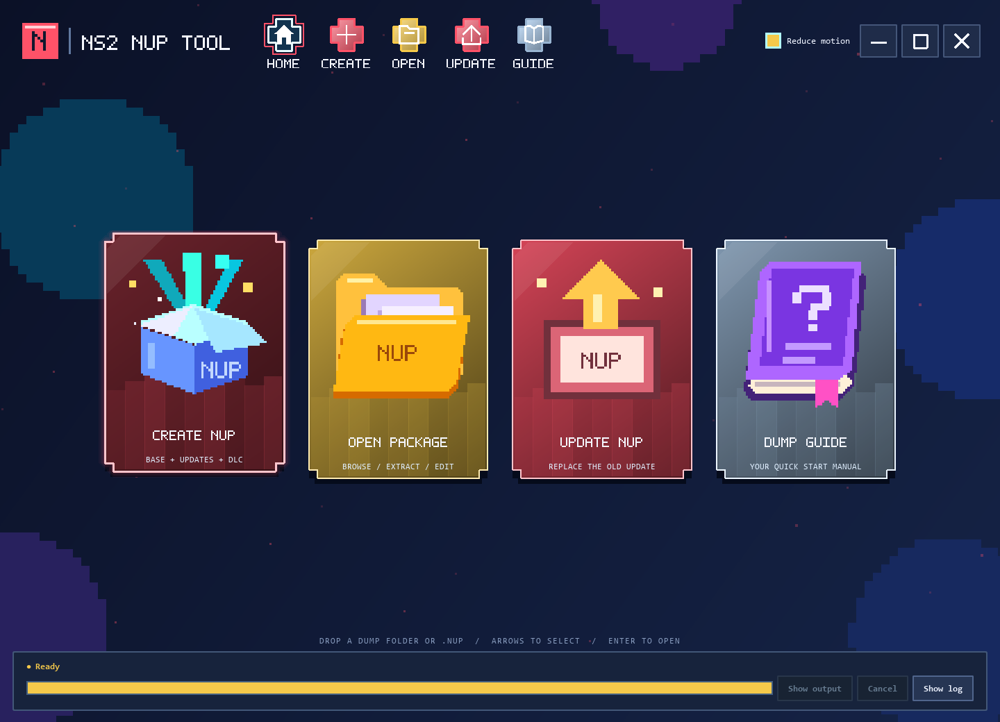

<div align="center">



# NS2 NUP Tool

**Your decrypted dump. One organized package. A little pixel nostalgia.**

[](https://github.com/SmokeyMcGames/NS2-NUP-Tool/actions/workflows/windows.yml)
[](LICENSE)


[User guide](docs/GUIDE.md) · [Build from source](#development-and-builds) · [Report a bug](https://github.com/SmokeyMcGames/NS2-NUP-Tool/issues/new/choose) · [Release status](docs/RELEASING.md)

</div>

A Windows desktop app for packing **already-decrypted ExeFS/RomFS dumps** into NUP v1. Bring base content, updates, and DLC together; discover metadata; inspect, extract, edit, and verify containers from an animated retro interface.

Compatible with the format published by **[a55uka/nup](https://github.com/a55uka/nup)**. Credit for the NUP format and upstream reference implementation belongs to its author and contributors. NS2 NUP Tool now uses its **own GPLv3 backend**; no reference implementation code is required or bundled.

> **Portable Windows app · GPLv3 source**
>
> Get the complete Windows ZIP from [Releases](https://github.com/SmokeyMcGames/NS2-NUP-Tool/releases). Tagged builds run the full test suite and packaged checks before publishing the app, checksums, and corresponding source materials. See [release details](docs/RELEASING.md).



*The real Classic Red dashboard. Pixel sprites and lettering are drawn by the app; no Nintendo logos or game artwork are included.*

## Four places to get things done

| Area | What you can do |
| --- | --- |
| **Create NUP** | Scan base/update/DLC content, fill metadata and artwork, choose compression, and build a verified container. |
| **Open Package** | Browse package details and files, extract the entire NUP or one package, edit metadata, and verify hashes. |
| **Update NUP** | Replace older updates with a newer decrypted update or update-only NUP, preserve DLC, and save a verified copy. |
| **Dump Guide** | Check folder conventions, version handling, and workflow notes without leaving the app. |

## At a glance

- Automatic title ID, executable build ID, NACP metadata, and artwork discovery.
- Optional Nintendo US lookup, with exact-ID automatic matching and manual review fallback.
- Whole-NUP extraction and metadata-preserving repacking; selected-package extraction remains available.
- Update replacement, V0 warnings, supported flat-folder correction, and optional use of an update as the base.
- Streamed Zstandard compression, SHA-256 verification, cancellation, and protected output paths.
- Classic Red pixel art, moving backgrounds, animated transitions, large artwork, and Reduce motion.

Use content you are authorized to access and process. This tool does not provide game downloads, decryption keys, firmware, or an emulator. See [Data and privacy](docs/PRIVACY.md).

## Run the portable app

Download the Windows x64 ZIP from [Releases](https://github.com/SmokeyMcGames/NS2-NUP-Tool/releases), or [build from source](#development-and-builds). Extract the whole archive and open `NS2 NUP Tool.exe`. Keep the entire `NS2 NUP Tool` folder together, including `_internal`; no separate Python installation is needed. Builds are unsigned, so Windows may show its usual downloaded-app warning.

1. Open **Create NUP**, choose a decrypted dump folder and a new `.nup` output outside that folder. Choosing a folder starts a scan.
2. Review packages, automatically detected metadata, and any layout problems that must be corrected.
3. Automatic Nintendo eShop lookup fills remaining name, publisher, and artwork fields when the product page confirms the detected title ID. If it cannot find an exact match, use **Find missing info online…** to search by game title or paste a product URL and select the correct result. Every metadata field can also be edited manually.
4. Set compression and create. Full SHA-256 verification is enabled by default.
5. Use **Open NUP** to browse, extract, edit metadata, or verify an existing container. Selecting a NUP through Browse opens it automatically; Open also works for typed or pasted paths.

Folders and `.nup` files can also be dropped onto the window. Inputs are processed locally. No game data is uploaded. This app does not decrypt encrypted NSP, XCI, or NCA files.

The frameless **Classic Red** retro dashboard has native pixel sprites, stepped borders, four large tiles, Home/Create/Open/Update/Guide navigation beside the title, and in-app minimize/maximize/close buttons. Drag the title area to move, double-click it to maximize/restore, and drag an edge to resize. Pages and workflow tabs slide, zoom, and fade from different directions; transparent snapshots keep the animated background visible. Tiles float with clearance inside their borders and lift on focus. Background shapes drift in both directions and every star moves at a different speed. Use Left/Right and Enter on the home tiles; Alt+Home returns to the dashboard. **Reduce motion** disables transitions and idle movement and saves your preference. Game artwork is shown in larger 192–256px frames. The progress bar shares the lower status row with Show output, Cancel, and Show log.

The initial window prefers 1440×1040 logical pixels and fits the available desktop. Navigation, tiles, artwork, spacing, and text adapt when resized; form text remains at least 9pt. Qt handles Windows monitor DPI separately, avoiding double scaling. Longer forms scroll on smaller screens, and the shop review keeps its action buttons outside the scrolling area. There is one Classic Red theme and no theme selector.

## Extract an entire NUP and repack it

**Open → Extract** defaults to **Entire NUP — base, updates and DLC**. All package files, including empty files and empty directories, are restored and every file is SHA-256 checked. The new output folder contains:

```text
Game-dump/
  base/
  updates/<numeric version>/
  dlc/<16-digit title ID>/<index>/
  .ns2-nup/
```

Choose **Game-dump itself** in Create to repack every package. Keep `.ns2-nup` with the dump: it preserves original package identities, versions, flags and metadata (including icons, localized metadata and private records). It is consumed by this tool and is not added to game content. Empty or duplicate packages are retained through the manifest; duplicate base/update paths receive a `-package-<index>` suffix. Newly added normal update/DLC folders are still discovered. Missing manifest-listed package folders stop creation instead of producing an incomplete NUP. Display version continues to follow the app's V-number policy unless overridden.

Choose **Selected package only** to extract only the package selected above, with optional subtree extraction. This mode does not create a full bundle or metadata sidecar. The destination must be new in both modes; failures and cancellation do not publish incomplete output.

Create and update addition exclude dump-tool files named exactly `.listing` by default. Enable **Include dump-tool .listing files** when creating a NUP to retain them. Full extraction still restores every file already stored in a NUP, including any `.listing` files; enable that option when repacking if you want to retain those artifacts. All other files inside each package are included. Loose files and folders at the dump root are included in the base (or first package); name collisions are rejected. Unrecognized content under `updates/` or `dlc/` blocks creation with the paths listed so it cannot be silently omitted or misclassified as base content. Correct those folders before packing. The optional **Replace base with update ExeFS and RomFS** mode still intentionally replaces original base content as described below; leave it off for an unchanged payload round trip.

## Add newer updates to an existing NUP

### Use an update as the base

Under **Create → Compression & create**, **Replace base with update ExeFS and RomFS** is available when the scan finds a matching update's nonempty `exefs/main`. If you have not explicitly chosen the toggle, Create asks **Use update as base**, **Keep standard loading**, or **Cancel**. The default remains standard loading. The setting resets for a different dump; it selects the highest numeric update version that contains main, including V0 when that is the available update.

Enabled, the new NUP's base contains only the selected update's complete `exefs/` and `romfs/` folders. Original base-only files are omitted, including files outside those folders. This is full replacement, with no fallback to original base content. A missing update RomFS stays absent and is called out in the hint and popup. NPDM and build ID come from the update; absent update NPDM is not replaced by the original base's metadata. Source files are never overwritten. The update remains a separate included package and DLC is unchanged. The existing flat-folder correction still applies when needed.

This targets the requested Eglantine/PokeDinner workflow. It is a compatibility option, not an emulator setting or a guarantee of gameplay compatibility. [NUP v1](https://github.com/a55uka/nup/blob/meow/SPEC.md) has no standardized launch-selector flag. The output uses ordinary v1 trees; tool-private metadata tag `0x8000`, identified by `NS2NUPTool:replace-base-content:v2`, records the choice for this app. Consumers skip that marker. The package overview shows the choice, metadata editing preserves it, and later update replacement replaces both base folders again when the incoming update supplies main. An incoming update without main leaves the base intact. Existing 0.2.3 NUPs retain their recorded ExeFS-only overlay behavior; recreate a NUP to select the new full-replacement mode.

### Replace an update

Choose **Update NUP** on Home or **Update** beside the title. Open the existing NUP, then select a decrypted update folder, an update-only bundle (`updates/<numeric version>/`), or an update-only NUP. The same workflow is available under Open → Add updates. For a single folder containing exefs/romfs directly, the numeric version comes from its decimal folder name or the explicit numeric-version field.

Selecting an update with **Browse** checks it automatically and fills **Numeric version** from the folder, package, or available NPDM metadata, falling back to **0** with a warning. Review the game ID and versions, then save to a new `.nup`. **Recheck update** is available for pasted paths. Changing the numeric version also rechecks automatically when you leave the field. A mismatched game ID, known nonzero duplicate update, or known older version is rejected. V0 cannot establish update order, so the selected content replaces the existing update. If the source has no readable ID, an explicit same-game confirmation is required. The operation rechecks inputs when it runs.

The original NUP is preserved. **The newest incoming update replaces this game's previous update packages in the saved copy.** Older incoming versions are ignored. DLC content is retained; base content follows the recorded choice above, or remains unchanged for ordinary NUPs. The base and new update display version becomes `V<numeric update version>`; other retained metadata is kept. Retained compressed payloads are copied without recompression; only new decrypted content is compressed. The resulting container gets an identity-derived UUID reflecting its new package list. Every file's SHA-256 is verified before publishing the updated copy. Cancellation removes temporary output. The new update remains a separate package.

## Automatic metadata and Nintendo lookup

- The suggested output filename is `Game Title [TITLEID].nup`, using the current title and known 16-digit title ID. It updates after scanning, Nintendo lookup, or title edits. Until an ID is known, it uses the title alone. Windows-invalid filename characters are replaced. A manually chosen output path is preserved.
- Scanning reads title ID from `main.npdm`, build ID from the executable, and titles/publisher from decrypted `control.nacp`. Standard `icon_Language.dat`/PNG/JPEG artwork is discovered with localized names/icons. Both ordinary and compressed NACP title tables are supported, including Polish and Thai.
- Metadata is checked in the package root and common control/romfs/exefs/metadata folders. Newest update metadata takes priority, then bundle-level control, then base metadata. A folder name is only a labeled title suggestion when no original title is available.
- The default display version is `V` followed by the newest included numeric update version, such as `V458752`, or `V0` with no update. This is a package revision label, not a reconstructed marketing version such as 1.2.3. A nonempty manual version override is supported; packing a blank version uses the numeric default.
- Editing a detected field protects your choice. Changing the source clears automatically populated fields. Rescanning keeps manual edits. NSP Box snapshot labels are not used as original game metadata.
- Automatic lookup is enabled by default and can be disabled on the Source tab. It searches the public **Nintendo US** storefront by detected title ID, then available title text if needed. Only a product page with the exact application ID is imported automatically. A missing ID or unavailable match leaves manual title search available. The manual review rejects mismatched IDs and requires explicit confirmation when identity cannot be verified.
- The preview checks only missing fields and an untouched folder-name suggestion. Scanned and manual values remain intact. Store artwork is downloaded into the local app cache with its source URL; it is not added to the game dump or bundled into the app.
- The store does not determine the numeric version or executable build ID. Supported-language lists are not used to invent translated titles.
- Lookup sends search text and requests public pages/artwork; it never uploads game files. Nintendo's website/search implementation can change. A direct US product URL works independently of the search configuration. Offline scanning and conversion remain available if lookup fails.

NACP layout references: [Switchbrew NACP](https://switchbrew.org/wiki/NACP) and [libnx NACP definitions](https://github.com/switchbrew/libnx/blob/master/nx/include/switch/nacp.h).

## Supported layout

```text
My Game/
  base/
    exefs/
    romfs/
  updates/
    458752/
      exefs/
      romfs/
  dlc/
    040074a01bf13001/
      0/
        romfs/
```

Each content folder may contain ExeFS, RomFS, or both. A bare folder containing `exefs/` or `romfs/` becomes a single base package. Without `base/`, an `updates/` tree becomes standalone updates. Update folder names are decimal numeric versions. DLC title folders are 16 hexadecimal digits, with content inside index subfolders. The Scan tab lists recognized packages and unrecognized update/DLC paths that must be corrected. Files elsewhere inside each recognized package root are included, matching upstream.

NS2 NUP Tool also supports a single update directly in `updates/exefs` and/or `updates/romfs`, alongside `base/` or as an update-only bundle. A nonzero version in the NPDM META header can supply the numeric version ([NPDM layout](https://switchbrew.org/wiki/NPDM#Meta)). If no version is available, the app fills **0**, displays **V0**, and shows a warning beside the field. V0 is a placeholder, not a detected release; the update is still included when packing. Enter the actual numeric version if known. This fallback also works when replacing an existing NUP's update: the warning explains that version order cannot be verified, and the selected content replaces the previous update in a new copy. The original NUP stays unchanged.

**Automatic folder correction during Create NUP:** For a flat dump such as Pokopia, the app physically moves all contents of `updates/` into `updates/<Update version>/` before packing. A value of 0 produces `updates/0/`; a value of 65536 produces `updates/65536/`. Scan and the create summary preview this change. The complete directory is moved without copying or rewriting game files, including companion files and artwork. Successful creation keeps the corrected layout. Packing errors and cooperative cancellation restore the original layout. Already numbered layouts are unchanged; conflicting layouts are rejected. An abrupt process kill or power loss may interrupt the rename; the content remains in `updates/<version>/` or a `.nup-layout-*` folder beside it.

## Upstream feature coverage

| Reference feature | Desktop control |
| --- | --- |
| `pack`, base/updates/DLC, standalone updates | Create NUP → Source & packages |
| `--level` | Compression level, -5 through 22; default 3 |
| `--title-id` | Optional exact 16-hex override |
| `--name`, `--publisher`, `--display-version`, `--icon` | Names & artwork |
| `--lang-name`, `--lang-icon` | Localized metadata rows; multiple languages |
| `--keep-listings` | Include dump-tool `.listing` files |
| Progress / quiet CLI output | Background progress; detailed log shown on demand |
| `info`, `--tree`, `--depth` | Package metadata and tree expanded to the desired depth |
| `list` | Filterable all-file table with size, codec, SHA-256 |
| extraction | Entire NUP by default; selected package and optional subtree remain available |
| `edit`, package selection, set/clear fields | Keep / Set / Clear actions; edited copy or atomic original replacement |
| `verify`, `--fast`, `--max-problems` | Full/structure verification and problem-list limit |

Build IDs and available NPDM metadata are copied automatically. Metadata goes onto the base or first package on initial pack. An edit preserves all unspecified metadata, content extents, and package identity. Numeric package versions are not changed by display-version metadata.

## Data handling

- No existing output is overwritten by packing or extraction. Extraction requires a new folder. Metadata edits default to a new copy.
- Output is written in a unique temporary directory on the destination volume, validated, then published. Cancel cooperates at chunk boundaries and removes the operation's temporary output.
- Compression, extraction, and deep hashing stream payloads in 4 MiB chunks. TOC/tree metadata remains in memory; Zstandard's native memory use depends on the compression level.
- Packing needs conservative free space for all source bytes plus the largest file and overhead. Editing needs another container's worth of disk space. An unexpected I/O failure leaves the original intact.
- The project's `nup_core` backend reads and writes the published v1 layout. Streamed Zstandard output is not promised to be byte-identical to other writers; repeated runs with the same inputs and dependency versions are deterministic. New TOCs are 16-byte aligned; the reader also accepts older reference files with unpadded TOC sizes.
- Extraction rejects unsafe Windows names, case collisions, and repeated directory references, and validates content hashes before publishing the folder. Linked source entries are rejected.
- Abrupt termination or power loss can leave a `.nup-*` temporary directory next to the output. Cooperative cancellation cleans up. No automatic deletion of arbitrary stale folders is performed.
- UI preferences save the last selected input paths locally through QSettings. No telemetry or updater runs.

## Development and builds

Requires Windows x64, Python 3.12, Git, and PowerShell for setup. Dependencies are pinned. Official releases use Python 3.12.10. Standard setup does not download or install the upstream NUP implementation. Optional reference compatibility tests use a separate, ignored checkout; see [Contributing](CONTRIBUTING.md).

```powershell
git clone https://github.com/SmokeyMcGames/NS2-NUP-Tool.git
cd NS2-NUP-Tool
.\Setup.ps1
.\.venv\Scripts\python.exe main.py
.\Build.ps1
```

Run tests separately:

```powershell
.\.venv\Scripts\python.exe -m unittest discover -s tests -v
```

`Build.ps1` runs integration and Qt workflow tests, generates the code-native icon, and creates `dist/NS2 NUP Tool/` with PyInstaller. It then checks GUI startup and packaged operations, including update replacement, V0 fallback packing, expected failures and cancellation. Dependency scanning uses an isolated PATH so unrelated developer-tool DLLs cannot replace Windows/Qt dependencies. See [THIRD_PARTY_NOTICES.md](THIRD_PARTY_NOTICES.md) before distributing a bundle. The local app has no signing certificate or installer.

## Source map

- `main.py`: GUI / worker entry point.
- `ns2_nup_tool/app.py`: native desktop screens and workflows.
- `ns2_nup_tool/widgets.py`: reusable metadata/path forms and file-list model.
- `ns2_nup_tool/console.py`: animated home tiles and console-style navigation.
- `ns2_nup_tool/retro.py`: pixel lettering, native sprites, palettes, artwork frames, and frameless window controls.
- `ns2_nup_tool/updates.py`: update preview, identity/version checks, compressed-content merge, and full verification.
- `ns2_nup_tool/dump_metadata.py`: bounded NACP parsing, artwork discovery, metadata provenance.
- `ns2_nup_tool/eshop.py`, `eshop_dialog.py`: optional Nintendo US lookup and review UI.
- `ns2_nup_tool/jobs.py`, `worker.py`: child-process jobs, file-based progress IPC, cooperative cancellation.
- `ns2_nup_tool/backend.py`: discovery, validation, transactions, inspect/extract/edit/verify operations.
- `ns2_nup_tool/streaming.py`: bounded-memory compression and payload I/O.
- `nup_core/`: original GPLv3 format reader, writer, metadata codec, discovery, and validation.
- `tests/`: synthetic fixtures, upstream interoperability, failure handling, and Qt workflow tests.

## Validation boundary

The 0.3.0 local build passed **101 automated tests**, **37 packaged operation checks**, and packaged GUI startup/navigation/shutdown. Tests use synthetic base/update/DLC content and verify byte round trips, bidirectional reference interoperability, malformed-container rejection, metadata preservation, safe outputs, control parsing, storefront matching, and actual GUI-to-worker workflows. Current clean-runner results appear in [Actions](https://github.com/SmokeyMcGames/NS2-NUP-Tool/actions). See [the validation boundary](docs/VALIDATION.md). Container verification does not establish emulator support or successful gameplay.

## Contribute and get help

[Report a bug or request a feature](https://github.com/SmokeyMcGames/NS2-NUP-Tool/issues/new/choose), read [contribution guidance](CONTRIBUTING.md), and follow the [code of conduct](CODE_OF_CONDUCT.md). Report vulnerabilities privately through [the security policy](SECURITY.md). Do not upload game dumps, keys, firmware, or private information to issues or pull requests.

## License and acknowledgments

**Original NS2 NUP Tool code, documentation, and generated pixel artwork:** [GNU GPL version 3 only](LICENSE), copyright 2026 SmokeyMcGames and contributors. The software is provided without warranty.

**NUP format and reference implementation:** [a55uka/nup](https://github.com/a55uka/nup), specification/reference revision `744fb7e30ce3ace787f1839ee3e7f8a010e36c04`. The reference code is not vendored, relicensed, or included in our release. It can be fetched only for optional development interoperability tests. See [implementation provenance](docs/FORMAT_IMPLEMENTATION.md).

Built with Python, Qt/PySide6, Zstandard, and PyInstaller. See [NOTICE](NOTICE) and [THIRD_PARTY_NOTICES.md](THIRD_PARTY_NOTICES.md) for attribution and license boundaries.

Nintendo, Nintendo Switch, and Nintendo Switch 2 are trademarks of Nintendo. This independent project is not affiliated with, endorsed by, or sponsored by Nintendo or the NUP author. No commercial game content, Nintendo logos, or downloaded storefront artwork is included.
